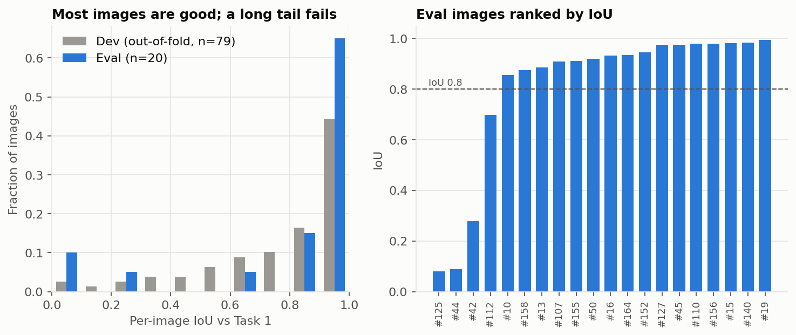
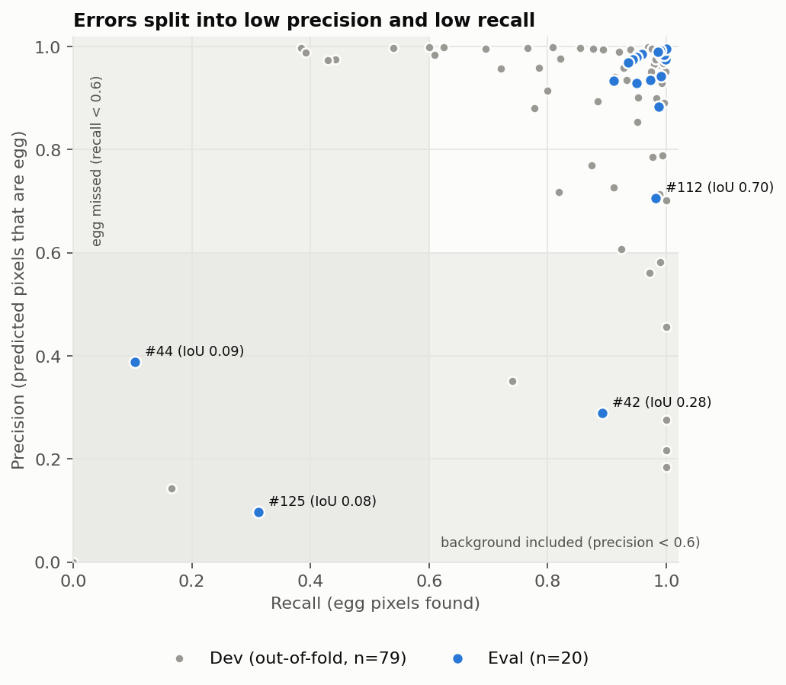
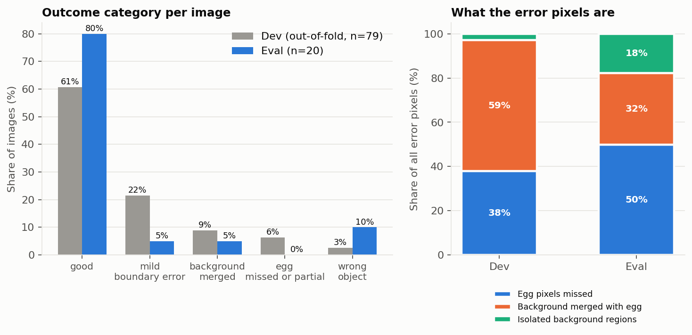
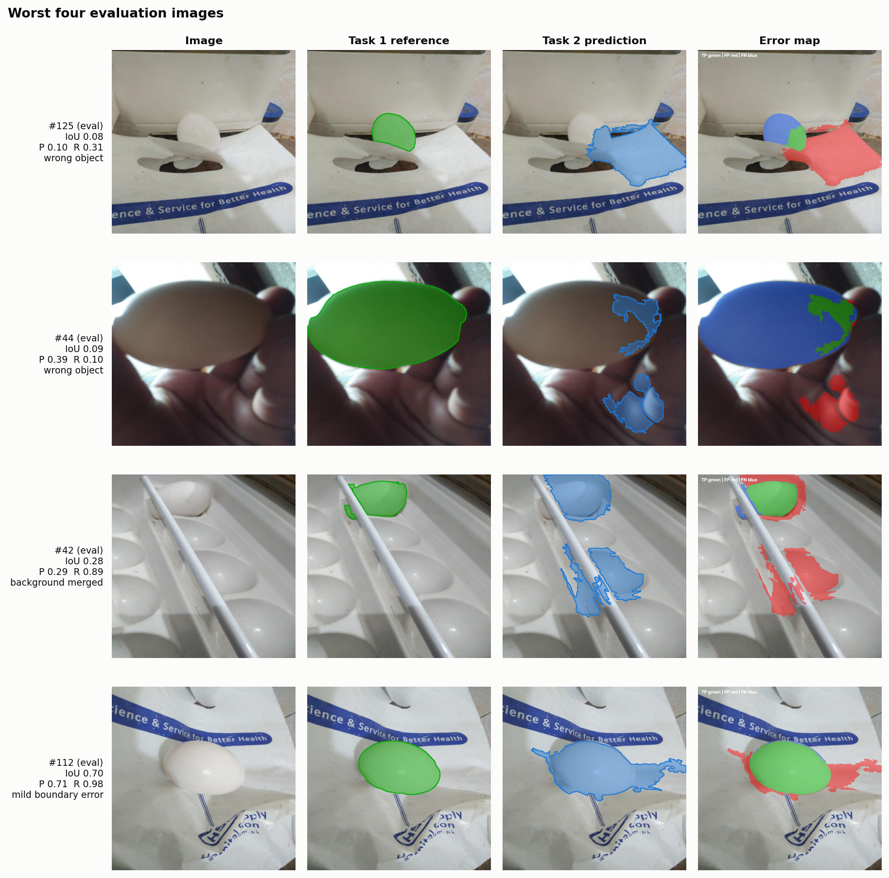
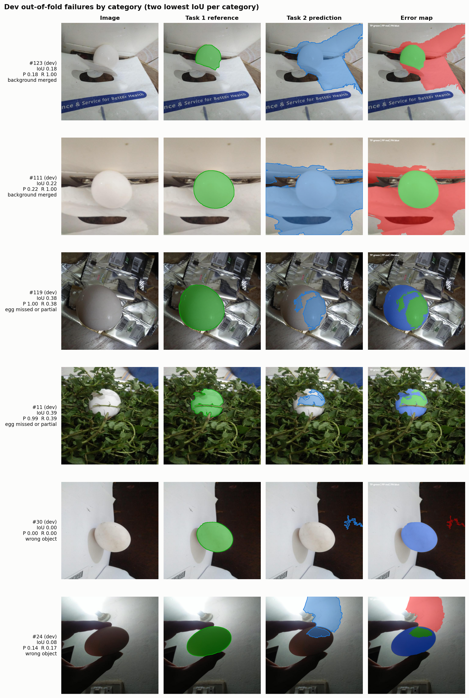
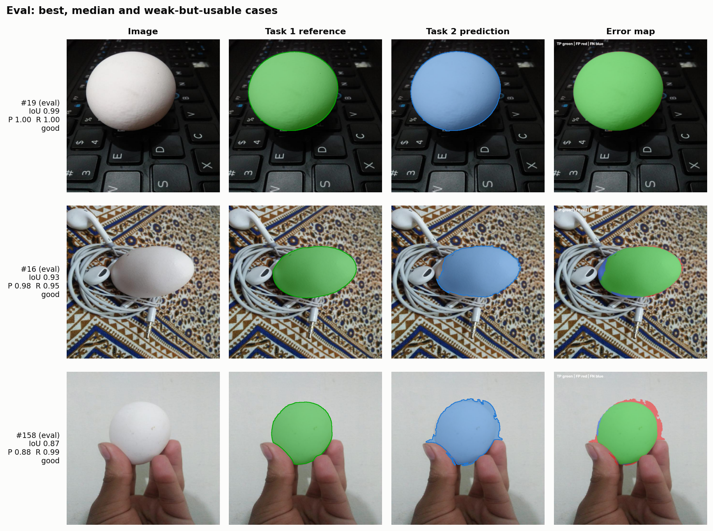
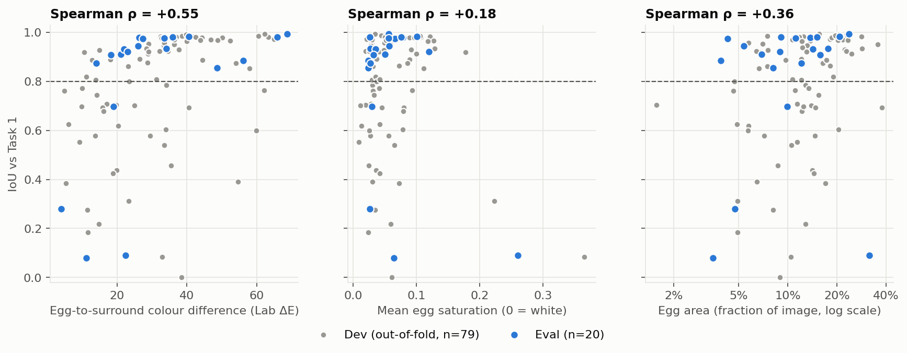

# Task 3: Evaluation and Analysis

Task 1 combined egg masks (OWL-ViT + SAM) are treated as ground truth. Predictions are the final Task 2 pipeline (Trial 11: Auto-Context Random Forest, hole filling, component shape filter). All numbers come from `scripts/task3_evaluation.py`; per-image values are in `reports/task3/per_image_metrics.csv`.

## Setup

- **Eval split (20 images):** one run of the final pipeline trained on all dev images. This is the unbiased headline number, but 20 images give wide intervals.
- **Dev split (79 images):** out-of-fold predictions, where each image is predicted by a model that never saw its similarity group. Dev was used to choose the method, so it is slightly optimistic, but it provides many more failures to analyse.
- **Metrics:** IoU, Dice, precision and recall per image, averaged (macro) and with pixels pooled over all images. Boundary F1 uses a `5 px` tolerance and HD95 is the 95th-percentile boundary distance. Instance detection counts a reference egg as found when one predicted component overlaps it with IoU `>= 0.5`. Intervals are 95% bootstrap over images (`5000` resamples).
- **Failure categories** (per image, from IoU `0.8`, precision and recall `0.6`): *good* (IoU `>= 0.8`); *background merged* (precision `< 0.6`, recall `>= 0.6`); *egg missed or partial* (recall `< 0.6`, precision `>= 0.6`); *wrong object* (both `< 0.6`); *mild boundary error* (everything else).

## Quantitative results

| Metric | Dev, out-of-fold (79) | Eval (20) | All (99) |
|---|---|---|---|
| IoU (macro) | 0.776 [0.723, 0.827] | 0.809 [0.669, 0.922] | 0.783 [0.733, 0.831] |
| Dice (macro) | 0.848 [0.801, 0.889] | 0.853 [0.726, 0.958] | 0.849 [0.805, 0.889] |
| Precision | 0.869 [0.818, 0.916] | 0.846 [0.719, 0.947] | 0.864 [0.816, 0.909] |
| Recall | 0.875 [0.827, 0.916] | 0.893 [0.777, 0.974] | 0.879 [0.835, 0.917] |
| Boundary F1 (5 px) | 0.618 [0.555, 0.682] | 0.677 [0.532, 0.803] | 0.630 [0.571, 0.687] |
| HD95, median (px) | 35.1 | 17.9 | 27.1 |
| IoU, median | 0.876 | 0.926 | 0.889 |
| IoU, pooled pixels | 0.756 | 0.741 | 0.753 |
| Images with IoU >= 0.8 | 61% | 80% | 65% |
| Images with IoU < 0.3 | 6% | 15% | 8% |
| Reference eggs detected | 76% | 91% | 79% |

**Reading the table.**
- **Two groups of images.** Scores are bimodal: median IoU is `0.89` but the mean is `0.78`. The 64 images rated *good* average precision `0.97`, recall `0.97` and median IoU `0.95`; the failures lose most of their score at once (Fig. 1).
- **Dev vs eval.** The eval mean is higher than dev, but the intervals overlap almost completely, so the two cannot be told apart. Treat `0.78` to `0.81` as the expected IoU, not as an improvement on eval.
- **Pooled vs macro.** Pooled IoU is lower than macro IoU because the failures are large regions (a whole carton, a large egg), which weigh more when pixels are summed.

## Where the gap comes from

| Category | Dev | Eval |
|---|---|---|
| good | 48 | 16 |
| mild boundary error | 17 | 1 |
| background merged | 7 | 1 |
| egg missed or partial | 5 | 0 |
| wrong object | 2 | 2 |

- **Failures are one of two kinds.** Points in Fig. 2 sit either with high recall and low precision (a background region was kept together with the egg) or with low recall (part or all of the egg was lost). Few images sit in between.
- **Isolated background fragments are largely solved.** Only `3%` of dev error pixels (`18%` on eval, from the tray fragments in `#42` and the hand in `#44`) are false positives in components that contain no egg, which is what the shape filter removes.
- **The remaining error is background attached to the egg or egg pixels missing.** In dev, `59%` of error pixels are false positives inside a component that also contains egg, and `38%` are missed egg pixels (eval: `32%` and `50%`). Component-level filtering cannot fix either, because the wrong pixels are inside a component that is otherwise right.
- **Boundaries are only moderately accurate even on good images.** Their median boundary F1 is `0.82` and HD95 about `12 px` on `640 x 640` images. The probability map is predicted at `320` pixels and upsampled, with no edge-aware refinement, so edges are smooth blobs that leak at contacts (Fig. 7, `#158` leaks along the fingers).

## Qualitative analysis

Overlay colours in the error maps: green true positive, red false positive (predicted, not egg in Task 1), blue false negative (egg in Task 1, not predicted).

- **`#125` (IoU 0.08, wrong object).** A white egg sits against a white carton. Only a small part of the egg is kept (recall `0.31`) and a carton flap beside it is added (precision `0.10`).
- **`#44` (0.09, wrong object).** An extreme close-up, with the dim egg filling half the frame. The model keeps a small bright patch of the egg (recall `0.10`) and selects the hand (precision `0.39`). Eggs this large are rare: only `5` of `99` images have an egg above `25%` of the frame, and four of them score `0.69` or higher.
- **`#42` (0.28, background merged).** A white egg in a white egg tray with a white rod. The egg is found (recall `0.89`) but tray and rod regions are added (precision `0.29`). It has the lowest egg-to-surround colour difference in the dataset (`4.1` Lab units).
- **`#112` (0.70, mild).** The egg is correct; white plastic bag is attached to its right side (precision `0.71`).

- **Background merged (`#123`, `#111`).** The egg sits on a white carton, and the whole carton is selected (recall `1.00`, precision `0.18` to `0.22`). Both egg and carton are bright, low-texture and similar in colour, so no pixel feature separates them.
- **Egg missed or partial (`#119`, `#11`).** Only a patch of a large egg is kept (precision about `1.0`, recall `0.38` to `0.39`). In `#11` leaves cover part of the egg, and in `#119` the egg has a smooth shading gradient and almost no contrast with the metallic background (ΔE `5.3`).
- **Wrong object (`#30`, `#24`).** In `#30` a white egg on a white wall is not found, and the best-scoring component is a speck elsewhere (the keep-best fallback picks something even when nothing is egg-like). In `#24` a backlit dark egg is overpowered by a glowing wall.

## What drives the errors

| Egg-to-surround colour difference (Lab ΔE) | Images | Mean IoU | Images with IoU < 0.5 |
|---|---|---|---|
| Low (< 22.8) | 33 | 0.64 | 27% |
| Middle | 33 | 0.83 | 9% |
| High (> 36.4) | 33 | 0.89 | 6% |

- **Contrast with the surroundings is the strongest driver** (Spearman `rho = +0.55`). The `14` images below IoU `0.5` (`11` dev, `3` eval) have median ΔE `19` against `32` for the rest. This is white-on-white, not whiteness itself: egg saturation is only weakly related (`rho = +0.18`, `p = 0.07`).
- **Small eggs fail more often** (`rho = +0.36`). Eggs under `5%` of the image area average IoU `0.56` (`40%` below `0.5`, `10` images), against `0.87` for eggs over `15%`. The close-up `#44` is the exception at the other end.
- **Pixel IoU hides instance errors.** Multi-egg images score well on pixels (mean IoU `0.87` against `0.77` for single-egg), but only `15` of `27` eggs in three-egg images are detected as separate objects. In dev `#142`, `#144` and `#148` three touching eggs form one component with IoU `0.93` to `0.98` and `0` of `3` eggs separated. A union mask cannot count eggs or follow them individually, which Task 4 needs.

## Limits of this evaluation

- **The reference is Task 1, not human labels.** The scores measure agreement with OWL-ViT + SAM, and Task 2 is trained on those masks. Task 1 errors (ten false positives were excluded from the split) would carry into every score.
- **The eval set is small.** The `95%` interval on eval IoU is `0.67` to `0.92`.
- **Leakage is reduced, not removed.** The nearest dev image to an eval image scores below the `0.950` CLIP cutoff, but the average is `0.92`, so similar scenes exist on both sides and eval may be somewhat optimistic.
- **The category thresholds** (`0.8`, `0.6`) are a choice for reporting, and the dev failures shaped the method, so dev patterns are not independent evidence.

## Potential improvements

Ordered by how much of the observed error each addresses.
1. **Add an egg-shape prior to separate white eggs from white surfaces.** The `14` images below IoU `0.5` are mostly low-contrast and merged cases, where pixel appearance alone cannot work. Candidate ellipses scored by edge support along their perimeter could re-rank or trim the kept component. This has not been tested and is the most direct next experiment.
2. **Split touching eggs into instances.** Needed for counting and for Task 4, and it would also expose merged background regions.
3. **Refine edges at full resolution.** Predict at `640` or refine the mask with an edge-aware step (guided filter or GrabCut seeded from the forest mask) to raise boundary F1 (`0.62` to `0.68`) and cut HD95.
4. **Handle large, partial and very small eggs.** Complete a kept partial region (convex hull or ellipse completion) for cases such as `#119`, `#11` and `#44`, and add training views with large and small eggs.
5. **Drop the keep-best assumption for video.** It always returns a component, so frames without an egg (or the white-egg-on-white-wall failure `#30`) produce a false detection. A confidence threshold on the best component would allow empty output.
