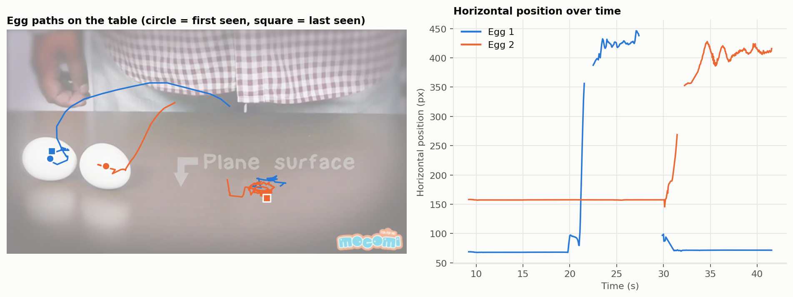
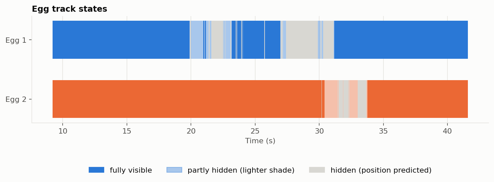
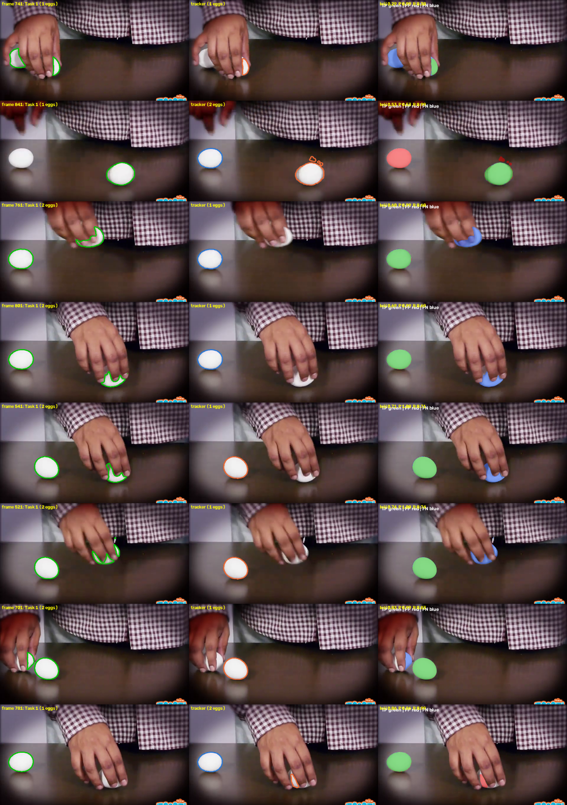

# Task 4: Video Tracking

The final Task 2 pipeline (Trial 11) is run on the assignment video (https://www.youtube.com/watch?v=Y4JyV94y2_A, saved as `video.mp4`) and extended with candidate filtering and a tracker so that each egg keeps its own identity. Per-frame tracks are in `outputs/task4/tracks.csv`; figures are in `reports/task4/figures/`. The annotated output video is on Google Drive: https://drive.google.com/file/d/1J1LyZ5amhyR-DFS8jQ2IINm2QukMPneT/view?usp=sharing

## The video

60 s, 24 fps, `640 x 360`, 1,440 frames. Eggs appear only from `9.2 s` to `41.6 s` (frames 221-997): two white eggs on a dark glossy table, moved and spun by a hand. Difficulties seen in the footage:
- **Hands cover or hold an egg** for up to about `2.5 s`, and a hand-held egg is lifted off the table.
- **Two near-identical eggs** that can be moved to each other's positions.
- **Egg size:** about `80 x 70` px (`4,400-4,800` px², 2% of the frame), at the small end of the dataset (eggs under 5% of the image averaged IoU `0.56` in Task 3).

## Method

Stage 1, per frame (`scripts/task4_detect.py`):
1. **Candidates.** Light, colorless pixels (Lab L `> 165`, HSV saturation `< 70`) are opened with a `5 x 5` kernel; blobs of at least `400` px, mean L `>= 200` and mean saturation `<= 35` survive. Pixels bright in more than 60% of sampled frames (the logo) are masked as a static overlay.
2. **Task 2 segmentation.** Each blob is cropped (side `160-256` px), enlarged to the training scale (`320 x 320`) and passed through the final Task 2 pipeline (Auto-Context Random Forest, hole filling, component features). The component overlapping the blob most is kept and mapped back. If it grows beyond `1.35x` the blob (it leaked into table sheen) it is trimmed to the blob's neighbourhood, and as a last resort the blob itself is used. A `9 x 9` opening removes spikes from motion blur.
3. **Validation.** A region is *strong* if its area is `1,500-9,000` px², aspect `<= 1.9`, solidity `>= 0.9`, mean L `> 200` and saturation `< 40`. Compact, white regions of at least `300` px² (`600` px² when used by the tracker) are *weak* (partly hidden eggs). Everything else is rejected.

Stage 2, tracking (`scripts/task4_track.py`):
- **Association.** A constant-velocity Kalman filter per egg; detections are matched by Hungarian assignment on distance (gate `60 px` plus `12 px` per missed frame, capped at `160`) and area ratio. Predicted velocity decays by `0.85` per hidden frame.
- **Occlusion.** A track survives `72` frames (`3 s`) without a detection and is drawn as a hidden egg at its predicted position. It stays available for re-identification for `360` frames (`15 s`).
- **Re-identification.** A strong detection that matches no live track first reclaims the nearest lost egg of plausible size, anywhere in the frame; a new egg is created only if its area is at least `70%` of the typical egg area. A track must collect `5` detections before it is reported, and a scene cut (mean frame change above `12`) ends all tracks.
- **Numbering.** Ids are assigned left to right at first sighting. Hidden or partial eggs are labeled in the video.

Outputs: annotated video (colored masks, ids, state, short trails), `tracks.csv` (frame, id, state, centroid, area, source), and the figures below. Detection takes about `20 min` on CPU (plus `2 min` to train and cache the Task 2 model once); tracking and rendering take about a minute.

## How the approach developed

| Step | Finding | Change |
|---|---|---|
| Task 2 pipeline on 8 frames, as is | Eggs outlined well, but `2-6` components kept per frame against `2` eggs (sheen, reflections, shirt checks); eggs under the hand came out as fragments | Add candidate proposals and validation in front of the segmenter; plan a tracker for occlusion |
| First size limits (from a visual estimate of `40-50` px eggs) | Wrong: measured blobs gave `80 x 70` px, mean L about `225-242` against `175-212` for shirt and sheen | Re-measured; limits, crop size and whiteness thresholds set from the blob table |
| Frame 561 | Task 2 component leaked into table sheen (`5,863` px against a clean `4,147` px blob) and was rejected, losing the egg | Trim the component to the blob's neighbourhood, else use the blob (`70` records use `task2+blob`, `12` use `blob`) |
| First tracker | `4` ids instead of `2`: the held egg's track matched `300` px shirt fragments and its predicted position drifted; when the egg reappeared `400` px away the `320 px` re-id gate failed | Ignore weak detections under `600` px, faster velocity decay, `15 s` re-id horizon without a distance limit, birth only for near-full-size eggs |
| Rendering | Red and green overlays are a color-blind trap; trails drew across re-id jumps and as scribbles inside resting eggs | Blue and orange from a validated palette; trails break at jumps, are cleared while hidden and drawn only when the egg has moved `30` px |

## Results

**Tracking.** Two ids are reported, both spanning the whole egg segment (frames `221-997`, `32.4 s`), with no gaps.

| | Egg 1 | Egg 2 |
|---|---|---|
| Fully visible | 596 frames (77%) | 696 frames (90%) |
| Partly hidden | 63 | 45 |
| Hidden (position predicted) | 118 | 36 |
| Longest hidden stretch | 59 frames (2.5 s) | 16 frames (0.7 s) |
| Largest jump between detections | 346 px (an egg carried under the hand) | 104 px |

Both eggs are fully visible together in `534` of `777` egg frames (`69%`). Of `1,400` detections, `1,318` come from the Task 2 pipeline directly.

**Identity.** The tracks show the hand events in the data (Fig. 1): Egg 2 stays at about `x = 157` px until `30 s` and is then carried to the right, while Egg 1 stays at about `x = 68` px until `20 s`, is carried to the right (`x = 400-450`), is hidden while the hand holds it (up to `2.5 s` at a time, Fig. 2) and is back at about `x = 71` px from `31 s`. Whether each id stays on the same physical egg through these hand events was checked by watching the output video; that check is manual, is not reproduced by the scripts, and no figure of it is included. There is no annotated ground truth, so id switches and MOTA are not measured.





**Segmentation against Task 1.** Task 1 (OWL-ViT + SAM) was run on every 20th egg frame (`39` frames, `221-981`) and compared with the union of tracked masks, as in Task 3.

| Measure | Value |
|---|---|
| Macro IoU / Dice | 0.913 / 0.946 |
| Macro precision / recall | 0.975 / 0.938 |
| Median frame IoU | 0.984 (`29` of `39` frames at `>= 0.95`, `8` below `0.9`, `1` below `0.5`) |
| Frames with both eggs found by both methods | IoU 0.979 (`29` frames) |
| Fully visible eggs: best IoU with a Task 1 egg | mean 0.967, median 0.987 (`n = 65`; `98%` at `>= 0.5`) |
| Partly hidden eggs | mean 0.586 (`n = 5`; `60%` at `>= 0.5`) |
| Tracked eggs matched to a Task 1 egg at IoU `>= 0.5` | 67 of 70 (Task 1 found 73) |



The `8` frames below `0.9` (Fig. 3) are almost all hand occlusions, and neither method is right there: the tracker reports a hand-held egg as hidden or as a small crescent (tracker egg count below Task 1's in frames `521, 541, 701, 761, 801`), while Task 1 outlines it with ragged edges through the finger gaps. In frame `841` Task 1 misses the left egg altogether, so the tracker's second egg is counted against it (precision `0.53`); in frame `781` the tracker's small crescent at the fingers has no counterpart in Task 1.

## Limitations

- **Hidden eggs have no mask.** For `154` egg-frames the position is a prediction, not a measurement, and an egg held in the hand is not segmented.
- **Settings were set on this one video.** Brightness, size and aspect limits come from this footage and may need changing for other scenes; the Task 2 model was not retrained on video frames.
- **Re-identification assumes no new egg enters.** A lost egg is reclaimed by the next strong detection within `15 s`, so a genuinely new egg appearing after one is lost would take its id. Eggs touching each other are not split; they were never merged in this video.
- **Spinning eggs are over-segmented.** The blur halo makes a spinning egg's mask `5,300-6,800` px² against `4,700` at rest.
- **Reference is imperfect.** Task 1 is not ground truth here (it misses an egg in frame `841` and misses or fragments hand-held eggs), so the `0.913` is agreement, not accuracy. The `39` frames are a regular sample, not the worst cases.
- **Speed.** About `1.5 s` per egg frame on CPU, so this is an offline method.

## Potential improvements

- **Complete hidden eggs.** Fit an ellipse of the typical egg size at the predicted position so hand-held eggs get an amodal mask, and split touching eggs by a size prior.
- **Handle blur.** Use an elongated-ellipse model or temporal smoothing of the mask for spinning eggs.
- **Measure tracking properly.** Annotate egg centers on a subset of frames and report id switches, fragmentation and MOTA, instead of relying on watching the video.
- **Speed up.** Reuse the previous frame's mask as a prior and segment only changed regions.

## Reproduce

```powershell
python scripts/task4_detect.py      # candidates and Task 2 segmentation for every frame (about 20 min, trains the model on first use)
python scripts/task4_track.py       # tracking, outputs/task4/tracks.csv and tracked_eggs.mp4
python scripts/task4_plots.py       # reports/task4/figures
python scripts/task4_evaluate.py    # Task 1 comparison on sampled frames (needs the Task 1 models; about 20 min on CPU)
```
